  

 

  
   
  

 

<h1 align="center">About Me</h1>

<!--

  
   
  

-->

**Lorem ipsum** dolor sit amet, consectetur adipiscing elit. Sed do eiusmod tempor incididunt ut labore et dolore magna aliqua.

 

 

<h1 align="center">Telemetry</h1>

<!-- Contribution streak -->

  

<!-- LeetCode + most used languages, side by side, full width -->

  
  

<!-- Activity graph, full width -->

  

<h2 align="center">Connect</h2>

  
  
  
  

<h2 align="center">Tech Stack</h2>

  
   
  
   
  

 
 
 

